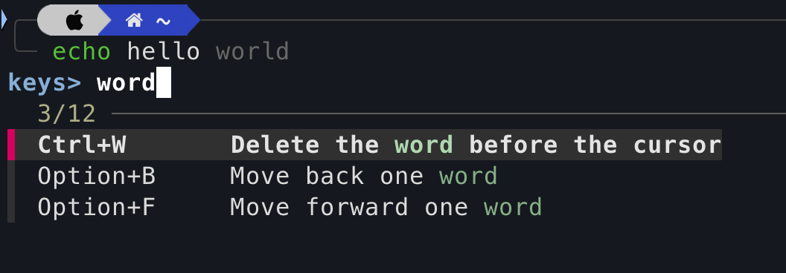
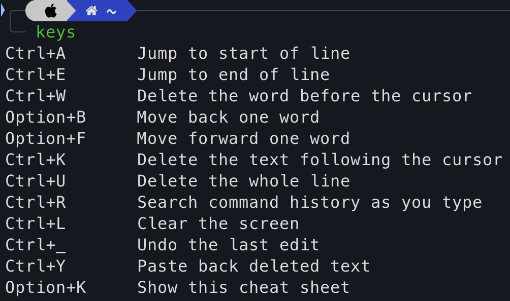
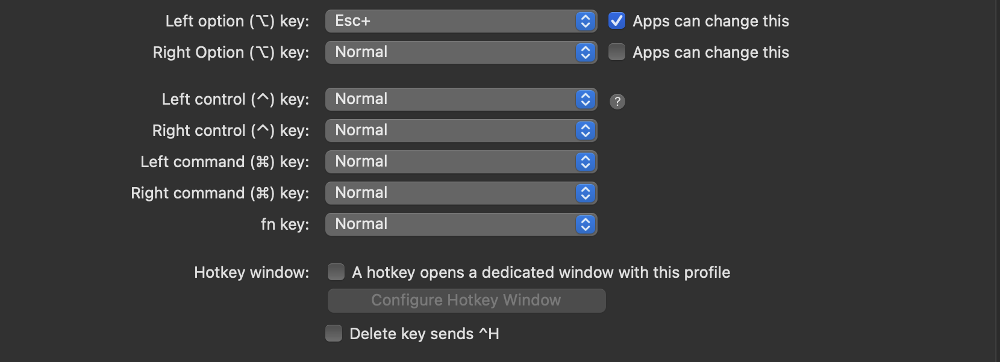

# zsh-keys

A cheat sheet for zsh command-line shortcuts, built from your shell's own key bindings. Press a hotkey while you're typing, search for what you want to do ("delete word"), and see which key does it.



Shortcuts like jumping to the start of a line or deleting a word save a lot of time once you know them, but they're easy to forget. The keys shown here are read live from your shell (`bindkey`), so they match your actual setup instead of a hand-typed list that might be wrong.

## Install

```
git clone https://github.com/kunduarjun/zsh-keys ~/.zsh-keys
echo 'source ~/.zsh-keys/keys.zsh' >> ~/.zshrc
```

Then open a new terminal tab.

## Usage

- `keys` prints the cheat sheet.
- `keys delete` prints only the lines containing "delete" (case-insensitive).
- **Option+K** opens the cheat sheet while you're typing a command, without disturbing what you've typed.
  - With [fzf](https://github.com/junegunn/fzf) installed, it's a live, fuzzy-filtered list: type to narrow it, Esc to close.
  - Without fzf, the full list appears below your prompt and disappears when you press the next key.



## Requirements

- **zsh.** Tested on zsh 5.9 on macOS (arm64). It's the default shell on macOS since Catalina. It won't work in bash.
- **Optional:** fzf for live filtering (`brew install fzf`).
- **The Option key must send Escape.** Shortcuts like Option+B only work if your terminal sends Option as Meta/Esc+.
  - **iTerm2:** Settings → Profiles → Keys → General → set *Left Option key* to **Esc+**.
  - **Terminal.app:** Settings → Profiles → Keyboard → tick *Use Option as Meta key*.



## Customize

Set the hotkey in `~/.zshrc`, above the `source` line, using `bindkey` notation (`^` is Ctrl, `^[` is Option/Esc):

```
KEYS_HOTKEY='^[h'
```

Add your own entries after the `source` line. Each entry is a zsh action name and a description, separated by `|`:

```
_keys_list+=("transpose-words|Swap the two words around the cursor")
```

To find an action name, run `bindkey | grep <word>`. An action that isn't bound on your machine is skipped.

## How it works

For each action in the list, the script scans the output of `bindkey` for every key bound to it, picks the shortest (usually the friendliest), and translates the notation (`^[b` becomes `Option+B`). The hotkey is a zsh line-editor widget, which is why it can appear while a command is half-typed.

## Limitations

- **zsh only.** Bash stores its shortcuts differently (readline), so it would need its own lookup step.
- **The list of actions and their descriptions is hand-picked.** The keys are generated, but the descriptions are not.
- **Unusual keys display roughly.** Raw terminal codes (like `^[[1;5C`, Ctrl+Right) aren't translated, and the letter after a Ctrl+X prefix always shows in capitals. The default list doesn't include any of these.
- **Only tested with zsh's default (emacs-style) key bindings.** In vi mode (`bindkey -v`), some actions may be unbound, and those lines are skipped.

## License

[MIT](LICENSE)
